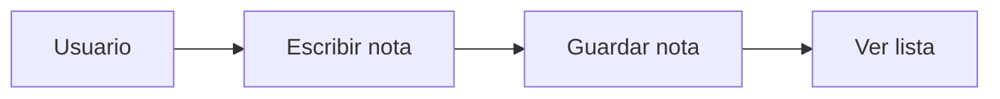

# Mi portafolio


Trabajos del curso Diseno de Interfaces de Programacion Avanzado, realizado en la semana 03 de clases. En este trabajo se sube un README mejor redactado, con más detalle y mejores elemento visuales que ayuden al entendimiento de como funciona y que hace nuestro proyecto. Está dirigido a todo el público que desea revisar mis primero trabajos de laboratorio.

## Tabla de contenidos

-	[¿Que es?](#que-es)
-	[¿Como se usa?](#como-se-usa)
-	[¿Cómo está construido?](#cómo-está-construido)
-	[¿Cómo se colabora?](#cómo-se-colabora)

## ¿Que es?
 
 Es un repositorio donde se puede ver mi portafolio, trabajos desarrollados en clase.
 
## ¿Como se usa?
 
Es un repositorio informativo, no realiza alguna acción. 

## ¿Cómo está construido?

Ésta construido por un archivo README donde explica el poyecto.

## ¿Cómo se colabora?

Pueden colaborar clonando el repositorio, ya que es un repositorio publico.
1. Copiar la direccion desde el boton Code
2. Ejecutar git clone con esa direccion
3. Entrar a la carpeta con cd

## Instalación
HTML

```html
<h1>Mis notas</h1>
<ul id="lista"></ul>
```

Funcion que agrega la nota:

```js
 function agregar() {
    const texto = document.getElementById("nota").value; const item = document.createElement("li"); item.textContent = texto; document.getElementById("lista").appendChild(item);
}
```

## Estado de las funciones
| Comando | Que hace |
|:--------|:------:|
| git add | Prepara los cambios |
| git commit | Guarda la version |
| git push | Sube los cambios al remoto |

## Hoja de ruta
- [x] Laboratorio 01: Git basico
- [x] Laboratorio 03: Trabajo colaborativo
- [x] Laboratorio 04: Marckdown
- [ ] Laboratorio 05: Markdown Avanzado


## Arquitectura



## Contribución 
Lee la [guia de contribucion](CONTRIBUTING.md) antes de enviar cambios.